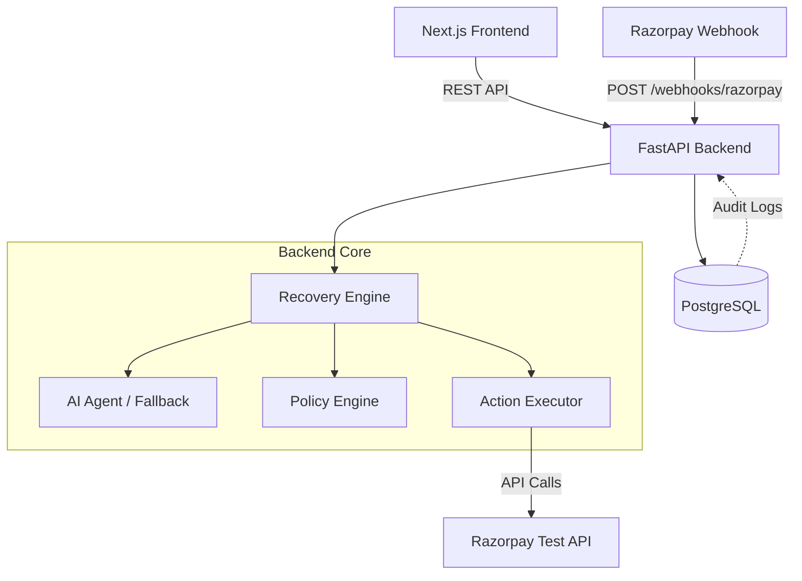

# RevivePay Architecture

RevivePay is designed as a single backend application paired with a modern Next.js frontend, focusing on clear data flow, deterministic policy enforcement, and auditable outcomes for revenue recovery.

## System Overview

## Core Components

### 1. Webhook Handler (`app/api/webhooks.py`)
- Receives events (`payment.failed`, `payment_link.paid`) from Razorpay.
- Verifies HMAC signatures securely.
- Ensures idempotency by tracking `razorpay_event_id` and skipping duplicate events.
- Upserts customer and payment records, and triggers the recovery workflow for new failures.
- Captures recovery verifications for successful payment links.

### 2. Recovery Engine (`app/services/recovery_engine.py`)
- The central orchestrator for the recovery pipeline.
- Coordinates between the AI, the deterministic policy guardrails, and the action executor.
- Writes immutable entries to the `AuditLog` at every major transition (creation, diagnosis, policy check, execution, verification).

### 3. AI Agent / Deterministic Fallback (`app/services/ai_agent.py`)
- Responsible for classifying the failure, providing a confidence score, and recommending a recovery action.
- **AI Mode**: When `OPENAI_API_KEY` is provided, uses `gpt-4o-mini` with structured output to analyze the failure context.
- **Fallback Mode**: When the API key is missing or disabled (e.g., during regression testing), it seamlessly falls back to a deterministic, rule-based classifier based on the Razorpay error code and reason.

### 4. Policy Engine (`app/services/policy_engine.py`)
- A strict, deterministic guardrail system that cannot be bypassed by the AI.
- Evaluates the AI's recommendation against business rules (e.g., `amount <= 500,000`, `recovery_score >= 0.3`).
- Outputs a definitive `PolicyDecision`: `APPROVE`, `BLOCK`, or `MANUAL_REVIEW`.
- Only approved actions proceed to execution.

### 5. Action Executor (`app/services/action_executor.py`)
- Executes the approved recovery action.
- Currently supports creating Razorpay Payment Links (`create_payment_link`).
- Interfaces with the `RazorpayClient` to make actual API calls to the Razorpay Test environment.

## Database Design

The application uses PostgreSQL with SQLAlchemy ORM.

### Key Models
- **Payment**: Tracks the core Razorpay payment attempt and failure reason.
- **Customer**: Tracks customer contact information for recovery outreach.
- **RecoveryCase**: The central entity representing a recovery lifecycle for a failed payment. Tracks status, risk amount, recovered amount, and the AI/Policy decisions.
- **RecoveryAction**: Represents a specific action taken (e.g., sending a payment link) and stores the resulting metadata (like `provider_id` or URLs) in JSON format.
- **AuditLog**: An append-only table recording every decision, ensuring the system can always answer *why* a particular action was taken.
- **WebhookEvent**: Tracks processed Razorpay event IDs to guarantee idempotency.

## Demo Mode and Simulation
To ensure reliable presentations, a `POST /api/demo/scenarios` endpoint allows injecting synthetic webhooks that exactly match Razorpay's format. This enables end-to-end testing of the pipeline (including AI, policy, and UI rendering) without requiring real-time external failures.
